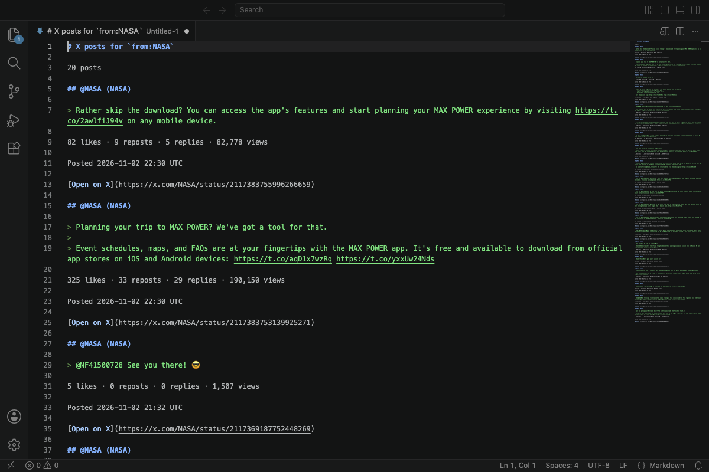
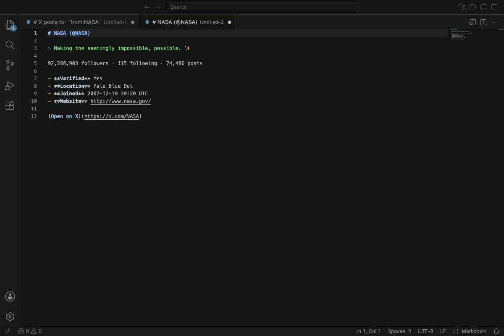
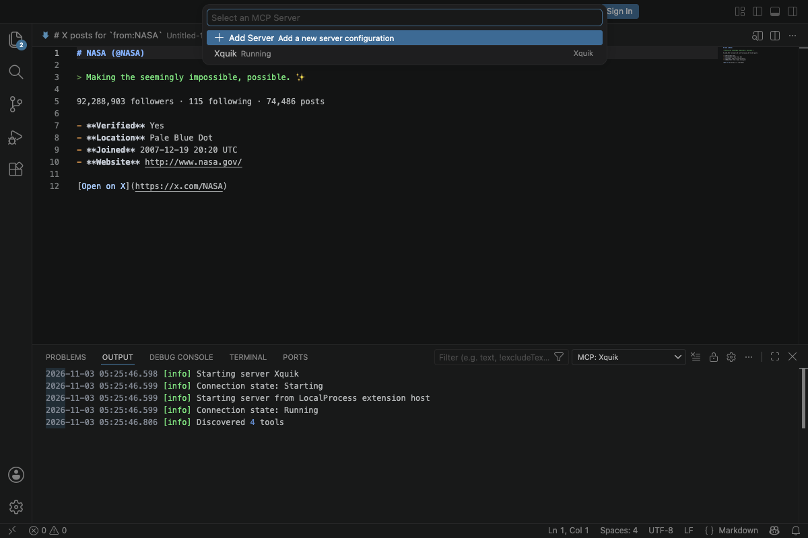

# MCP X (Twitter) Extension for VSCode, Cursor & Windsurf by Xquik

[](https://youtu.be/4UOSpoOoC3Y?t=367)\
[Watch Framer build a tweet ticker with Xquik, from 6:07](https://youtu.be/4UOSpoOoC3Y?t=367).
This extension connects your editor to Xquik MCP.

Use this MCP X (Twitter) VSCode extension by Xquik to search from your editor.
It also looks up profiles and adds the hosted Xquik MCP server.

Xquik is the world's fastest and cheapest X (Twitter) data API with the most complete X (Twitter) data.
Most other Apify Actors charge before filtering or deduplication.
Xquik charges only for delivered, unique, filter-matching results and never pads rows.
Xquik is independent and not affiliated with X Corp.

<!-- trust:win:start -->

The Xquik REST API read 45 tweets per second on 2026-10-15. That cost $0.15 per 1,000. The fastest of 4 rival Actors read 12.5 per second. The cheapest cost $0.173 per 1,000. [Compare each run](https://xquik.com/benchmarks#benchmark-x-tweet-scraper). Most rival Actors charge before they filter or dedup. Xquik charges only for delivered, unique, filter-matching results.

<!-- trust:win:end -->

## Install the X (Twitter) MCP for VSCode

The extension isn't on the VS Code Marketplace or Open VSX yet.
Build it from its source, then install the `.vsix` file.
You need Node.js 22 or newer and VS Code 1.101 or newer.

```sh
git clone https://github.com/Xquik-dev/xquik-vscode.git
cd xquik-vscode
npm ci
npm run package
code --install-extension dist/xquik-*.vsix
```

VSCodium, Cursor & Windsurf use their own command in place of `code`.

```sh
codium --install-extension dist/xquik-*.vsix
cursor --install-extension dist/xquik-*.vsix
windsurf --install-extension dist/xquik-*.vsix
```

You can also select **Install from VSIX** in the Extensions view menu.

## Sign in

1. Copy an API key from [your account page](https://dashboard.xquik.com/en/account?tab=api-keys).
2. Open the Command Palette.
3. Run `Sign In With API Key` from the Xquik category.
4. Paste your key.

A command that needs a key asks you to sign in first.

## Search X (Twitter) posts

Run `Search X Posts` from the Xquik category.
Type a query such as `from:NASA`.
The tweets open in a Markdown tab.



Next, read the [MCP setup](#use-the-x-twitter-mcp-server), the [command table](#commands) or the [MCP docs](https://docs.xquik.com/mcp/overview).

<!-- trust:start -->

## Benchmarks & usage

[](https://xquik.com/benchmarks#speed)
[](https://xquik.com/benchmarks#skill-installs)

- 8.6 s p99 REST server read time over 7 days, failures included ([source](https://xquik.com/benchmarks#speed)) <!-- trust:rest-p99 8555 -->
- 1,600+ installs of Xquik's X (Twitter) Skills on skills.sh ([source](https://xquik.com/benchmarks#skill-installs)) <!-- trust:skill-installs 1640 -->

Checked on 2026-11-13. See each number with its date & source on [xquik.com/benchmarks](https://xquik.com/benchmarks) or as [JSON](https://xquik.com/trust.json).

<!-- trust:end -->

## Look up an X (Twitter) profile

Run `Look Up X Profile` with a username or profile link.
The profile opens in a Markdown tab.



## Use the X (Twitter) MCP server

The hosted server URL is `https://xquik.com/mcp`.
Your AI assistant reads X (Twitter) data through it.



### VS Code & VSCodium

The extension adds the server for you.
Start it from the MCP server list.

The server uses your API key after you sign in.
Restart the server after you sign in or out.

VSCodium hides MCP servers until you turn on AI features.
After you sign in, select **Turn On AI Features**.
You can also set `chat.disableAIFeatures` to `false` in Settings.

### Cursor

The extension adds the server for you.
Open Cursor Settings, then Tools & MCP, to see it.

The server uses your API key after you sign in.
Signing in or out updates the server.

### Windsurf

1. Run `Copy MCP Config` from the Xquik category.
2. Open `mcp_config.json` from the Cascade MCP menu.
3. Paste the config.
4. Enable Xquik.

```json
{ "mcpServers": { "xquik": { "serverUrl": "https://xquik.com/mcp" } } }
```

The config holds no secret.
Cascade runs Xquik OAuth when you enable the server.

## Commands

| Command                | What it does                                                       |
| ---------------------- | ------------------------------------------------------------------ |
| `Sign In With API Key` | Saves your key once Xquik accepts it.                              |
| `Sign Out`             | Removes your key from this editor.                                 |
| `Search X Posts`       | Opens up to 20 matching posts in a Markdown tab.                   |
| `Look Up X Profile`    | Opens a profile in a Markdown tab.                                 |
| `Copy MCP Config`      | Copies the server config. It appears only in editors that need it. |

`Search X Posts` & `Look Up X Profile` take 1 optional text argument.
A keybinding can skip their prompt with `args`.

```json
{ "key": "ctrl+alt+x", "command": "xquik.searchPosts", "args": "from:NASA" }
```

## Prices

Pay-as-you-go reads cost $0.00015 per post and per profile.
[Monthly plans](https://xquik.com) cost up to 20% less.

## Limits

- A search or profile lookup needs an API key and credits.
- A search opens up to 20 posts.
- The commands only read X (Twitter) data. They never post, like or follow.
- The MCP server can also act through X (Twitter) accounts you connect on xquik.com.

## Privacy

- Your key lives in your editor's secret storage.
- Your key goes only to xquik.com.
- The extension sends no telemetry.

## Questions

### Do I need an X (Twitter) developer account?

No. Public reads need only an Xquik API key.
Private reads & account actions need a connected X (Twitter) account.

### Is this the official X (Twitter) API?

No. Xquik runs its own REST API.
The extension calls that API, not the official X (Twitter) API.

## More Xquik tools

- The [X (Twitter) API alternative skill](https://github.com/Xquik-dev/x-api) & [X (Twitter) advanced search operators](https://github.com/Xquik-dev/x-twitter-advanced-search).
- X (Twitter) agent plugins for [OpenClaw](https://github.com/Xquik-dev/tweetclaw) & [Hermes Agent](https://github.com/Xquik-dev/hermes-tweet).
- The [X (Twitter) API documentation source](https://github.com/Xquik-dev/xquik-docs).
- X (Twitter) integrations for [n8n](https://github.com/Xquik-dev/n8n-nodes-xquik), [Prefect](https://github.com/Xquik-dev/prefect-xquik), [Haystack](https://github.com/Xquik-dev/xquik-haystack), [Paperclip](https://github.com/Xquik-dev/paperclip-plugin-xquik), [Convex](https://github.com/Xquik-dev/xquik-convex), [Supabase](https://github.com/Xquik-dev/xquik-supabase) & [Strapi](https://github.com/Xquik-dev/strapi-plugin-xquik).
- X (Twitter) MCP for [AI agents](https://github.com/Xquik-dev/xquik-mcp) & [Raycast](https://github.com/Xquik-dev/xquik-raycast).
- [Xquik X (Twitter) API](https://xquik.com) and the [X (Twitter) API documentation](https://docs.xquik.com/api-reference/overview).

Xquik is an independent third-party service. Not affiliated with X Corp. "Twitter" and "X" are trademarks of X Corp.
